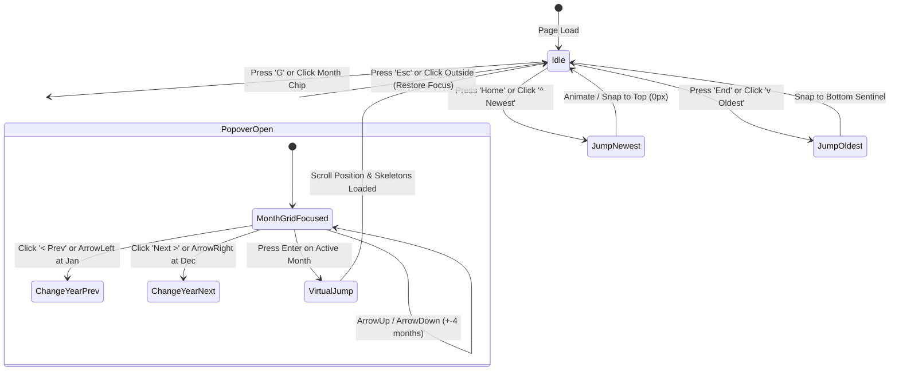

# Timeline Jump & Fast Navigation Feature Specification

**Date:** November 5, 2026  
**Status:** Approved for Implementation  
**Module:** `apps/web/src/features/gallery/TimelineJump` & `packages/shared`

---

## 1. Overview & Problem Statement

In large photo collections (~5,700+ media items spanning multiple years), continuous linear
scrolling is slow and tedious when attempting to reach memories from 3 to 5 years ago. Users require
an instant, non-linear jump capability that allows jumping directly to any specific year and month
without fetching or rendering the intermediate thousands of media records.

---

## 2. ASCII Wireframes

### 2.1 Top Bar Month Chip Popover Trigger

```
+--------------------------------------------------------------------------------------------------+
|  [|||]  [ October 2026 v ] (G)               Photos | Videos | Favorites           [-]  [+] (Z)  |
+--------------------------------------------------------------------------------------------------+
```

### 2.2 Month Grid Popover (4x3 Grid with Active-Filter Counts)

```
+------------------------------------------------------------+
|  < Prev Year                  2026              Next Year >|
+------------------------------------------------------------+
|  [ Jan (42) ]    [ Feb (0)  ]    [ Mar (115)]    [ Apr (68) ]  |
|  [ May (210)]    [ Jun (84) ]    [ Jul (340)]    [ Aug (19) ]  |
|  [ Sep (95) ]    [*Oct(150)*]    [ Nov (0)  ]    [ Dec (0)  ]  |
+------------------------------------------------------------+
|  [ Home: Jump to Newest ]            [ End: Jump to Oldest ]|
+------------------------------------------------------------+
|  Keys: Arrows navigate | Enter selects | Esc closes dialog |
+------------------------------------------------------------+
```

### 2.3 Floating "Newest" / "Oldest" Quick-Jump Pills

```
+--------------------------------------------------------------------+
|                                                                    |
|                                                                    |
|   [ ^ Newest ] (Home)                                              |
|                                                                    |
|   ... continuous photo grid ...                                    |
|                                                                    |
|   [ v Oldest ] (End)                                               |
|                                                                    |
+--------------------------------------------------------------------+
```

---

## 3. Keyboard Navigation State Machine



---

## 4. API & Data Contract

### 4.1 Filter-Aware Month Buckets Endpoint

`GET /api/files/photos/months?type=all|photos|videos&accountId=:accountId`

**Response (`PhotoMonthBucket[]`):**

```json
{
  "months": [
    { "label": "October 2026", "year": 2026, "month": 10, "count": 150 },
    { "label": "September 2026", "year": 2026, "month": 9, "count": 95 },
    { "label": "March 2024", "year": 2024, "month": 3, "count": 115 }
  ]
}
```

### 4.2 Shared Pure Functions (`packages/shared`)

```ts
export function formatMonthKey(year: number, month: number): string;
export function parseMonthKey(key: string): { year: number; month: number } | null;
```

### 4.3 Virtual Jump Keyset Windowing

When jumping to a month that is not currently in memory:

1. Lookup the cumulative index offset of the month via the `months` list.
2. Render instant skeleton cards with matching section header to prevent visual flicker.
3. Fetch photo slice for that month via `getPhotos({ offset: monthOffset, limit: 120, type })`.
4. Smoothly scroll container to the newly mounted section.
