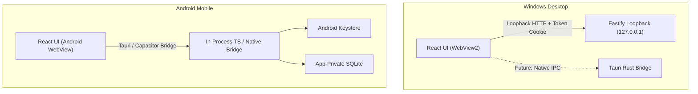

# Sunflower Drive — Portability & Cross-Platform Architecture Audit

> **Scope**: Windows Desktop (`.exe` / `.msi` via Tauri v2) and Android Mobile Readiness.  
> **Stage**: Stage 6 Deliverable  
> **Status**: Frozen Specification & Roadmap

---

## 1. Codebase Module Classification

Every module across Sunflower Drive is classified into three operational categories:

| Module / Path                                 |    Category    | Status & Portability Roadblocks                                                           | Replacement for Android / Pure Seam                                                    |
| :-------------------------------------------- | :------------: | :---------------------------------------------------------------------------------------- | :------------------------------------------------------------------------------------- |
| **`packages/shared/src/vault/*`**             | **Pure Logic** | **100% Portable as-is**. Uses standard WebCrypto (`crypto.subtle`) and pure typed arrays. | None needed. Runs directly in WebViews, Node, and Kotlin/Rust via test-vectors.        |
| **`packages/shared/src/index.ts`**            | **Pure Logic** | **100% Portable as-is**. TypeScript interfaces and schemas.                               | None needed.                                                                           |
| **`apps/server/src/utils/fts-sanitizer.ts`**  | **Pure Logic** | **100% Portable as-is**. Unicode regex tokenization.                                      | None needed.                                                                           |
| **`apps/server/src/utils/outbound-guard.ts`** | **Pure Logic** | **100% Portable as-is**. URL parsing and validation rules.                                | Plug into platform HTTP client.                                                        |
| **`apps/server/src/utils/path-safety.ts`**    | **Pure Logic** | **100% Portable**. Path resolution and containment logic.                                 | Ported to platform filesystem abstraction.                                             |
| **`apps/server/src/db/connection.ts`**        | **Node-Bound** | Direct dependency on `better-sqlite3` and Node `path`/`fs`.                               | Interface `DatabaseConnection`. On Android: SQLite Android framework or SQLCipher.     |
| **`apps/server/src/auth/keychain.ts`**        | **Node-Bound** | Direct dependency on `@napi-rs/keyring`.                                                  | Interface `SecretKeyStore`. On Android: Android Keystore + EncryptedSharedPreferences. |
| **`apps/server/src/auth/session.ts`**         | **Node-Bound** | Fastify request hooks and loopback cookies.                                               | On Android: In-process direct call bridge or Android WebView IPC.                      |
| **`apps/server/src/sync/oauth-client.ts`**    | **Node-Bound** | Direct dependency on `googleapis` Node SDK.                                               | Direct fetch against Google Drive REST v3 using standard `fetchWithGuard`.             |
| **`apps/web/src/**/*`**                       |  **UI (Web)**  | **100% Portable Web Code**. React 19, Tailwind CSS, Lucide icons.                         | Reused directly in Tauri Windows WebView2 and Android WebView.                         |

---

## 2. Native Dependency Matrix: Windows Desktop vs. Android

| Dependency               | Purpose                 | Windows Desktop (Tauri)       | Android Mobile Equivalent                                           |     Migration Risk     |
| :----------------------- | :---------------------- | :---------------------------- | :------------------------------------------------------------------ | :--------------------: |
| **`better-sqlite3`**     | Local DB storage & FTS5 | Precompiled native Node addon | Platform `androidx.sqlite` / SQLCipher / `rusqlite`                 |         Medium         |
| **`@napi-rs/keyring`**   | OS Credential Keychain  | Windows Credential Manager    | Android Keystore System (`MasterKey`, `EncryptedSharedPreferences`) |          Low           |
| **`node:crypto`**        | AES-GCM, PBKDF2, CSPRNG | Bundled with Node runtime     | Standard `crypto.subtle` (WebCrypto API) or Android `Cipher`        | Zero (covered by SDV1) |
| **`googleapis`**         | Google Drive API client | Node client library           | Direct lightweight HTTPS calls to `googleapis.com/drive/v3`         |          Low           |
| **`node:fs` / `stream`** | Disk caching and piping | Direct Win32 filesystem       | Android Scoped Storage / app-internal cache directory               |         Medium         |

---

## 3. Platform Abstraction Seams (Interfaces)

To decouple core synchronization, caching, and cryptographic logic from the Node.js runtime,
Sunflower Drive introduces platform seams:

### 3.1 `SecretKeyStore`

```ts
export interface SecretKeyStore {
  get(service: string, key: string): Promise<string | null>;
  set(service: string, key: string, value: string): Promise<void>;
  delete(service: string, key: string): Promise<void>;
}
```

- **Windows Desktop**: `@napi-rs/keyring` (service: `sunflowerdrive`).
- **Android**: Android Keystore with AES-256-GCM hardware-backed master key.

### 3.2 `DatabaseConnection`

```ts
export interface DatabaseConnection {
  prepare<P extends unknown[], R>(sql: string): PreparedStatement<P, R>;
  exec(sql: string): void;
  pragma(pragmaStr: string): unknown;
  transaction<T>(fn: () => T): () => T;
  close(): void;
}
```

### 3.3 `HttpClient`

```ts
export interface HttpClient {
  fetch(url: string, init?: RequestInit): Promise<Response>;
}
```

Guarantees that `validateOutboundUrl` and SSRF inspection execute uniformly on all outbound calls
regardless of operating system.

---

## 4. Transport & Authentication Model Across Targets



- **Desktop**: Loopback HTTP (`127.0.0.1:<port>`) with random startup session cookie (`ds_session`).
  In Tauri release packaging, authentication can transition to native IPC commands (`invoke`).
- **Mobile**: Zero loopback. Android does not run a background daemon server. The UI communicates
  with the core via direct in-process JavaScript calls or WebView native interface bindings.

---

## 5. OAuth Differences: Desktop Loopback vs. Android Custom Tabs

### 5.1 Technical Flow Difference

- **Desktop**: Fastify spawns loopback redirect listener `http://127.0.0.1:<port>/auth/callback`.
  Google sends the authorization code back to localhost.
- **Android**: Loopback servers are prohibited on mobile. Instead:
  1. App launches **Chrome Custom Tabs** using the system browser.
  2. Redirect URI uses a custom scheme (e.g. `com.sunflowerdrive.app:/oauth2redirect`) or **Android
     App Links** (`https://app.sunflowerdrive.com/auth/callback`).
  3. Android OS catches the intent and resumes the app with the authorization code.

### 5.2 Legal & Google Policy Reality (Important Decision)

- **Personal / Developer Builds**: Users can supply their own Google Cloud OAuth Client ID and
  Secret (`credentials.json`). No verification required.
- **Public Play Store Distribution**: Distributing a public Android app requesting
  `https://www.googleapis.com/auth/drive.readonly` requires formal **Google Cloud Verification** and
  an annual CASA/OWASP Tier 2 security assessment.
- **Recommendation**: Launch desktop and Android initial versions with the **Bring-Your-Own-Client**
  model for zero verification overhead and complete decentralization.

---

## 6. Android Architectural Options Analysis

| Criteria            | Option A: Shared Rust Core                                                                                  | Option B: TypeScript Core in WebView                                                              | Option C: Native Kotlin App                                      |
| :------------------ | :---------------------------------------------------------------------------------------------------------- | :------------------------------------------------------------------------------------------------ | :--------------------------------------------------------------- |
| **Description**     | Rewrite DB, sync, and crypto in Rust; compile to native library (`.so`) for Android and `.dll` for Windows. | Keep sync, DB, and crypto in TypeScript running in the WebView using SQLite plugin and WebCrypto. | Re-implement everything natively in Kotlin with Jetpack Compose. |
| **Code Reuse**      | 95% UI, 70% backend logic                                                                                   | **90% UI and TypeScript business logic**                                                          | 0% backend, 0% UI (re-uses design only)                          |
| **Effort**          | High (~6–8 weeks)                                                                                           | **Low to Medium (~2–3 weeks)**                                                                    | High (~8–10 weeks)                                               |
| **Performance**     | Maximum                                                                                                     | High (SQLite plugin runs on C layer)                                                              | Maximum native                                                   |
| **Vault Spec**      | Uses Rust `aes-gcm` + `argon2`                                                                              | **Uses SDV1 WebCrypto + WASM Argon2id**                                                           | Uses Android `javax.crypto` + Argon2                             |
| **Background Sync** | Via Android NDK + WorkManager                                                                               | Via WorkManager invoking headless JS                                                              | Native Android `WorkManager`                                     |

### Recommended Decision: **Option B (Near-Term)** $\rightarrow$ **Option A (Long-Term)**

- **Near-Term (Next Milestone)**: Adopt **Option B** (Tauri Mobile / Capacitor WebView with platform
  SQLite and WebCrypto). It preserves 90% of our existing TypeScript test suite, the entire UI, and
  the exact SDV1 cryptographic implementation with minimal engineering overhead.
- **Long-Term**: As mobile traffic scales, transition sync bottlenecks into a shared Rust library.

---

## 7. Mobile-Specific Engineering Concerns

1. **Background Sync & Battery**: Android terminates background processes aggressively. Sync must
   use `androidx.work.WorkManager` with
   `Constraints.Builder().setRequiredNetworkType(NetworkType.UNMETERED).build()` (Wi-Fi only
   option).
2. **Scoped Storage**: App must store databases and thumbnails in `context.noBackupFilesDir` to
   prevent unencrypted cloud backups to Google Drive.
3. **Biometric Vault Unlock**: Android BiometricPrompt can unlock a credential stored in
   `AndroidKeyStore`, which wraps the Master Key. Biometric unlock is a convenient wrapper, never a
   replacement for the passphrase.
4. **Screenshot Protection**: The Vault view must set
   `window.setFlags(WindowManager.LayoutParams.FLAG_SECURE)` on Android to prevent screen recording
   and task-switcher previews.
