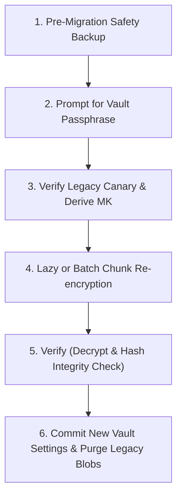

# Sunflower Drive Vault — Language-Agnostic Cryptographic Specification (SDV1)

> **Specification Version**: 1.0.0 (Frozen)  
> **Format Identifier**: `SDV1` (`0x53 0x44 0x56 0x31`)  
> **Design Gate**: Stage 4a Deliverable (Architecture & Specification)  
> **Target Platforms**: Node.js 22+ (Loopback Server), Modern Browsers (WebCrypto + WASM), Tauri
> Desktop (Rust), Android (Kotlin / WebCrypto)

---

## 1. Architectural Principles & Invariants

1. **Language-Agnostic Portability**: Primitives must be natively supported across WebCrypto
   (browsers, Node, Android WebView), standard Rust crates (`aes-gcm`, `argon2`, `hkdf`), and
   Java/Kotlin (`javax.crypto`).
2. **Standard Primitives Only**:
   - **Key Derivation Function (KDF)**: Argon2id (RFC 9106)
   - **Authenticated Symmetric Cipher**: AES-256-GCM (NIST SP 800-38D)
   - **Subkey Derivation (KDF)**: HKDF-SHA256 (RFC 5869)
   - **Entropy Source**: Cryptographically Secure Pseudorandom Number Generator (CSPRNG)
3. **Zero-Knowledge Core**: Plaintext and Master Keys never persist to disk unencrypted, are never
   transmitted over external network calls, and are purged (zeroized) upon vault lock.
4. **Chunked Streaming AEAD**: Supports constant-memory encryption/decryption of arbitrary
   multi-gigabyte files and arbitrary byte-range random access (for video seeking).
5. **Re-keying Without Re-encryption**: Changing the vault password re-wraps the Master Key only;
   existing encrypted files remain untouched.

---

## 2. Key Hierarchy & Derivation

```text
User Passphrase ───────(Argon2id + Salt)───────▶ Key Encryption Key (KEK)
                                                           │
                                                  AES-256-GCM Unwrap
                                                           ▼
                                                    Master Key (MK)
                                                    [256-bit CSPRNG]
                                                           │
                                     ┌─────────────────────┴─────────────────────┐
                           HKDF-SHA256(MK, Salt_File)                 AES-256-GCM Wrap (Recovery)
                                     ▼                                           ▼
                              File Subkey (FK)                         Wrapped by Recovery Key
                                     │                                 (High-Entropy Backup)
                           ┌─────────┴─────────┐
                     Metadata Header      1 MiB Chunks
                     (AES-256-GCM)       (AES-256-GCM)
```

### 2.1 Master Key (MK)

- **Format**: 32 cryptographically random bytes (256 bits).
- **Generation**: `crypto.getRandomValues(new Uint8Array(32))` or `crypto.randomBytes(32)`.

### 2.2 Key Encryption Key (KEK) Derivation via Argon2id

- **Algorithm**: Argon2id (RFC 9106).
- **Parameters**:
  - Memory cost ($m$): $65536 \text{ KiB}$ ($64 \text{ MiB}$)
  - Time cost ($t$): $3 \text{ iterations}$
  - Parallelism ($p$): $4 \text{ threads}$
  - Salt length: $32 \text{ bytes}$
  - Derived key length: $32 \text{ bytes}$ ($256 \text{ bits}$)
- **Platform Performance Justification**:
  - **Modern PC / Laptop (x86_64, Apple Silicon)**: ~180–350 ms.
  - **Mid-Range Android Device (Snapdragon 7/8)**: ~350–600 ms.
  - Exceeds OWASP 2024 recommended minimums ($19 \text{ MiB}, t=2$) while remaining responsive for
    local-first interactive unlock.
- **Upgradability**: Parameters $\{m, t, p\}$ and `kdf_salt` are stored in the vault metadata header
  so they can be tuned upward in future versions.

### 2.3 Emergency Recovery Key

- **Format**: 32 cryptographically random bytes presented as a 24-word BIP-39 mnemonic phrase or
  43-character base64url string.
- **Derivation**: `RecoveryKey = SHA-256(RecoveryPhrase)`.
- **Purpose**: Wraps the Master Key independently. Allows full vault recovery if the passphrase is
  forgotten.

### 2.4 Per-File Subkeys (HKDF-SHA256)

- **IKM (Input Keying Material)**: Master Key (`MK`, 32 bytes).
- **Salt**: 32 cryptographically random bytes generated uniquely per file (`FileSalt`).
- **Info**: Fixed string `sunflower-vault-v1-file-key` (UTF-8).
- **Output (OKM)**: 32 bytes ($256 \text{ bits}$) used exclusively to encrypt that specific file's
  header and data chunks.

---

## 3. Vault Container File Format (`.sdv`)

Every encrypted vault file consists of an **Authenticated Header** followed by a stream of **1 MiB
Authenticated Chunks**:

```text
+-------------------+--------------------+----------------------+--------------------------+
| Magic Bytes (4B)  | Format Version (2B)| KDF / Salt Block (40B)| Encrypted Metadata Block |
| "SDV1"            | 0x0001             | [FileSalt + Nonce]   | [Ciphertext + 16B Tag]   |
+-------------------+--------------------+----------------------+--------------------------+
| Chunk 0 (1 MiB + 16B Tag)              | Chunk 1 (1 MiB + 16B Tag)                       |
+----------------------------------------+-------------------------------------------------+
| ...                                    | Final Chunk N (Remaining Bytes + 16B Tag)       |
+----------------------------------------+-------------------------------------------------+
```

### 3.1 Header Specification (Plaintext Prefix + Encrypted Metadata)

1. **Magic Bytes** (4 bytes): `0x53 0x44 0x56 0x31` (ASCII `"SDV1"`).
2. **Format Version** (2 bytes, big-endian unsigned integer): `0x00 0x01` ($1$).
3. **File Salt** (32 bytes): Random per-file salt used in HKDF.
4. **Header Nonce** (12 bytes): Unique 96-bit IV for the metadata block.
5. **Encrypted Metadata Length** (4 bytes, big-endian unsigned integer): Length of the metadata
   ciphertext.
6. **Encrypted Metadata Ciphertext**: AES-256-GCM ciphertext of JSON metadata:
   ```json
   {
     "name": "original-filename.ext",
     "mimeType": "image/jpeg",
     "sizeBytes": 104857600,
     "modifiedAt": 1730764800000,
     "thumbnailIv": "...",
     "thumbnailTag": "..."
   }
   ```
7. **Header Auth Tag** (16 bytes): AES-256-GCM authentication tag verifying the header.

---

### 3.2 Chunked Streaming AEAD Specification

To ensure memory safety and allow seekable video streaming:

- **Chunk Size**: $1\,048\,576 \text{ bytes}$ ($1 \text{ MiB}$) of plaintext per chunk.
- **Cipher**: AES-256-GCM.
- **Chunk Nonce Construction (96 bits / 12 bytes)**:
  ```text
  [4 bytes: Random File-Prefix] [7 bytes: Chunk Counter (Big-Endian)] [1 byte: Flags]
  ```
  - **Random Prefix** (4 bytes): Matches the first 4 bytes of HKDF output or per-file prefix.
  - **Chunk Counter** (7 bytes): Monotonically increasing chunk index starting at $0$. Defends
    against chunk reordering.
  - **Flags** (1 byte):
    - `0x00`: Intermediate chunk.
    - `0x01`: Final chunk. Defends against file truncation attacks.
- **Chunk Auth Tag**: 16 bytes appended directly to each chunk.
- **Encrypted Chunk Size**: $1 \text{ MiB} + 16 \text{ bytes} = 1\,048\,592 \text{ bytes}$ (last
  chunk is $\text{RemainingBytes} + 16 \text{ bytes}$).

### 3.3 Random-Access Range Decryption (Video Seeking)

To decrypt arbitrary byte range $[Start, End]$ without decrypting the entire file:

1. Compute starting chunk: $C_{start} = \lfloor Start / 1\,048\,576 \rfloor$.
2. Compute ending chunk: $C_{end} = \lfloor End / 1\,048\,576 \rfloor$.
3. Seek directly to file offset:
   $$\text{Offset}(C_i) = \text{HeaderLength} + C_i \times (1\,048\,576 + 16)$$
4. Read and decrypt chunks $C_{start}$ through $C_{end}$ using each chunk's deterministic nonce.
5. Slice decrypted buffer to exact byte boundary $[Start, End]$.

---

## 4. Encrypted Thumbnails Isolation

1. **Storage**:
   - Encrypted thumbnails are stored either in `data/vault/thumbs/<fileId>.sdvt` or directly in the
     SQLite `vault_files.encrypted_thumb` column.
2. **Isolation Guarantee (Inviolable)**:
   - Vault thumbnails are **never** written to the plaintext cache (`data/thumbs/`).
   - Plaintext thumbnails exist **only** in client memory while the vault session is unlocked.
   - Decrypted blobs in the UI are bound to temporary `blob:` URLs that are revoked
     (`URL.revokeObjectURL`) when the vault locks or the thumbnail component unmounts.

---

## 5. Threat Model & Security Invariants

| Attack Vector                       | Protected? | Security Guarantee                                                                                                             |
| :---------------------------------- | :--------: | :----------------------------------------------------------------------------------------------------------------------------- |
| **Google Cloud / Drive Inspection** |  **YES**   | Content, metadata, filenames, and thumbnails are opaque ciphertext authenticated with AES-256-GCM.                             |
| **Disk Inspection at Rest**         |  **YES**   | Files are unreadable without Master Key; Master Key is unreadable without Argon2id passphrase.                                 |
| **Chunk Reordering / Swap**         |  **YES**   | Chunk counter embedded in nonce ensures chunk $N$ cannot be substituted for chunk $M$.                                         |
| **File Truncation Attack**          |  **YES**   | Final-chunk flag (`0x01`) in nonce prevents an attacker from truncating trailing chunks without detection.                     |
| **Brute-Force Attack**              |  **YES**   | Argon2id ($64 \text{ MiB}, t=3$) imposes steep computational and memory cost on offline cracking rigs.                         |
| **Malware Running on Workstation**  |   **NO**   | _Honest boundary_: A keylogger or root process on the host OS while the vault is unlocked can access memory or log keystrokes. |
| **Weak Passphrase**                 |   **NO**   | Passphrase entropy is enforced at setup: minimum 10 characters, evaluated via zxcvbn (score $\ge 3$).                          |

---

## 6. Migration Plan from Legacy Format

### 6.1 Legacy vs. SDV1 Comparison

- **Legacy Format**: Single-pass AES-GCM; key derived via PBKDF2; canary ciphertext stored in
  `vault_settings`; whole-file ciphertext stored as single SQLite BLOB
  (`vault_files.encrypted_payload`).
- **SDV1 Format**: Master Key hierarchy, Argon2id KDF, recovery key, chunked 1 MiB streaming AEAD
  container.

### 6.2 Safe 4-Step Migration Pipeline



1. **Pre-Migration Backup**: Automatically snapshot `vault_settings` and `vault_files` into
   `data/backups/pre-vault-migration-<timestamp>.db`.
2. **Authentication**: User inputs passphrase; backend verifies legacy canary.
3. **Master Key Generation**: Generate 256-bit Master Key `MK`; wrap `MK` with Argon2id-derived KEK;
   generate recovery phrase.
4. **Data Migration with Resumability**:
   - Each legacy file is decrypted in memory, hashed (SHA-256), chunked, and encrypted into SDV1
     format.
   - SDV1 ciphertext is validated by immediate test decryption and hash verification before writing.
   - If interrupted, an `upgrade_state` table records progress; resumption continues from the last
     completed file.
   - Rollback is instantaneous via the pre-migration backup database.
